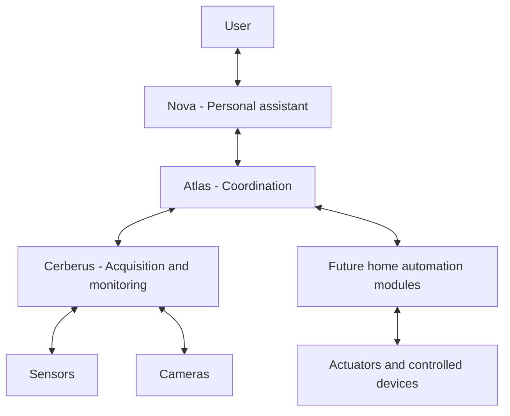

# Project Synapse

**A Modular AI Ecosystem for Personal Assistance and Home Automation**

Project Synapse is a learning and development project bringing together conversational AI, sensor and camera management, and home automation. Its long-term goal is a connected system in which specialized modules share information and carry out defined operations through a common coordination layer.

The project spans desktop and edge computing. Raspberry Pi is the platform used for the current embedded prototype, while the voice assistant runs on an Apple Silicon Mac. Additional devices and deployment options will be introduced as individual modules develop.

## The ecosystem

| Component | Role in the target system |
|---|---|
| **Nova** | The personal assistant: conversation, user requests and spoken communication of results |
| **Atlas** | The coordination layer: module status, events, operations and shared access to recordings and information |
| **Cerberus** | Sensor and camera management: acquisition, monitoring, event detection and surveillance |
| **Future home automation modules** | Specialized control of actuators and device-specific functions within the home installation |

Nova provides the conversational interface, Atlas connects requests with defined module operations, and Cerberus supplies observations from sensors and cameras. Future actuator modules will extend this ecosystem with physical control functions.

## Target architecture

**The following diagram describes the intended architecture. The module connections are planned and are not yet implemented.**



The intended interaction is a request passing from Nova to Atlas, then to the responsible module. That module will return its actual result or status for Atlas and Nova to present to the user. Operation interfaces, validation rules and failure handling still need to be designed and tested.

## Current status

| Component or workstream | Status | Available today |
|---|---|---|
| **[Nova](nova/README.md)** | Prototype with Online/Local modes | Voice conversation, session-level speaker verification and local persistent memory; full spoken cross-conversation validation remains pending |
| **[Hardware Control Center](docs/control-center.md)** | Earlier embedded prototype | NTC/PCF8591, buttons and LED code remains available; this circuit is no longer the current breadboard setup |
| **Python/Keras experiments** | Learning and experimentation | Standalone notebooks for data preparation, model training and evaluation |
| **Atlas** | Planned | Coordination responsibilities defined; no shared runtime or module integration yet |
| **Cerberus** | Motion-triggered capture prototype | HC-SR501 on GPIO18 triggers the camera C API and saves a 640×480 RGB PPM; first Raspberry Pi capture reported by the student |
| **Home automation modules** | Planned | Dedicated actuator control modules and their interfaces remain to be developed |

Nova and the C prototype currently run independently. The repository does not yet provide an integrated home automation system, autonomous actuator management or a completed surveillance service.

## Repository and getting started

| Area | Contents | Entry point |
|---|---|---|
| `nova/` | Local voice assistant and its environment snapshot | [Nova README](nova/README.md) and [installation guide](nova/INSTALL.md) |
| `cerberus/src/`, `cerberus/include/` and `cerberus/Makefile` | Raspberry Pi acquisition and GPIO prototype | [Hardware Control Center guide](docs/control-center.md) |
| `Keras_Practice/` | Standalone AI and Deep Learning experiments | Notebooks and accompanying data in that directory |
| `docs/` | Component documentation and hardware illustrations | [Control Center hardware, build and limitations](docs/control-center.md) |

### Nova

**NOVA** stands for **Neural Omnimodal Virtual Agent**. The name expresses the module’s long-term vision; the current prototype provides turn-based voice conversation.

Nova uses local Whisper Large V3 Turbo and Qwen3-TTS with a private FRIDAY reference. **Online** uses GPT-6 Luna and Jev; **Local** uses Ollama Qwen3.5 4B MXFP8 and GLiClass Multilang Mini. Both use local Multilingual E5 Small embeddings, persistent Qdrant storage and SpeechBrain speaker verification. Online mode sends conversation/extraction and retrieved context to OpenAI, and classification text to TypeSafe; see the [Nova README](nova/README.md) for data boundaries and limitations.

With the environment, model weights and private assets available:

```sh
cd nova
.venv/bin/python nova.py
# Or select a mode at startup:
.venv/bin/python nova.py online
.venv/bin/python nova.py local
```

Without a mode, select Online or Local in the window. The selectors hide during preparation; conversation unlocks when ready. Stop clears conversation identity and context. Personal memory requires Alberto's voice verification at the start of each conversation; the enrolled profile persists between launches. Guests cannot access or save personal memories. The voice threshold is provisional, and replay or a different person taking over an authenticated conversation remain limitations.

Implicit memory proposals require confirmation; retrieval uses owner-filtered candidates. Memory editing/deletion, contradiction handling, wake word activation and agentic tools remain future work. Default terminal output shows salient events and errors; add `--verbose` for timings, warnings and diagnostics. Full spoken cross-conversation memory validation after the latest fixes remains pending; automated and isolated integration checks do not replace it.

OmniVoice experiments and local validation suites are development-only files and are excluded from version control.

Private voice assets are excluded from version control and are not distributed. A source checkout alone does not include everything required for speech synthesis. See the [installation guide](nova/INSTALL.md) and [dependency snapshot](nova/requirements.txt) for the public setup information.

### Cerberus

The current Raspberry Pi setup uses Camera Module 3 NoIR and an HC-SR501 (L jumper, OUT on BCM GPIO18 / physical pin 12). From `cerberus/`, run `make cerberus`, create `images/` if absent, then run `./cerberus`. A rising GPIO edge calls `acquire_and_save_frame`; the default output is `images/camera-frame.ppm`, overwritten at each capture. An optional first argument supplies a complete output path. Capture is synchronous; latency, queued-event behavior and sustained operation still need evaluation. Face detection, identity recognition and pre/post-event clips are not implemented.

### Earlier embedded prototype

The Hardware Control Center runs on Raspberry Pi/Linux with the configured NTC/PCF8591 circuit, GPIO buttons and LED. See its [dedicated guide](docs/control-center.md) before building or connecting hardware; it contains the earlier prototype wiring assumptions, build commands, behavior and known limitations.

## Roadmap

1. **Consolidate Nova:** continue evaluating conversational quality, resource use, bounded context and explicit persistent-memory controls.
2. **Introduce Atlas:** define module interfaces, status and event models, and verifiable operations; connect Nova to this coordination layer.
3. **Extend Cerberus:** consolidate motion-triggered capture, then add bounded pre-event history, event-triggered recordings and transfer to Atlas.
4. **Evaluate event analysis:** develop and compare Keras models for Cerberus, including recognition and alerts, using explicit datasets and evaluation criteria.
5. **Add home automation modules:** define device-specific actuator control, operating limits, state feedback and integration through Atlas.
6. **Extend access securely:** design identity, authorization, TLS, isolation and request limits before personal remote access; an iPhone client remains optional future work.

These are development goals, not features already delivered. Device choices, communication protocols and integration details will be settled through implementation and testing.

## Technologies and development approach

- **C on Linux/Raspberry Pi** for the current acquisition, concurrency and GPIO control work.
- **Python** for Nova and the planned AI and coordination services.
- **Keras** for data preparation, Deep Learning experiments, model evaluation and error analysis.
- **MLX, Whisper, Qwen and Ollama** for the current local conversational pipeline on Apple Silicon.

The project grows through concrete prototypes. Documentation distinguishes implemented behavior, manually reported results and planned work. Component guides retain the operational details and limitations of each prototype; the main README presents the ecosystem and its direction.

## Version-control scope

The published sources include Nova's official launcher and `nova_core/`, the embedded prototype, documentation and the Keras learning notebooks. Local test/probe directories (`nova/tests/`, `cerberus/tests/`, `test/`), Nova experiments (`nova/experiments/`), archived probes (`old/`) and personal notes (`Appunti/`) are excluded. Environments, model caches, private voice assets, recordings and generated application bundles are also excluded.

Ignoring a path does not remove files already present in earlier commits. These exclusions apply to future commits; local files remain available on the development machine.
