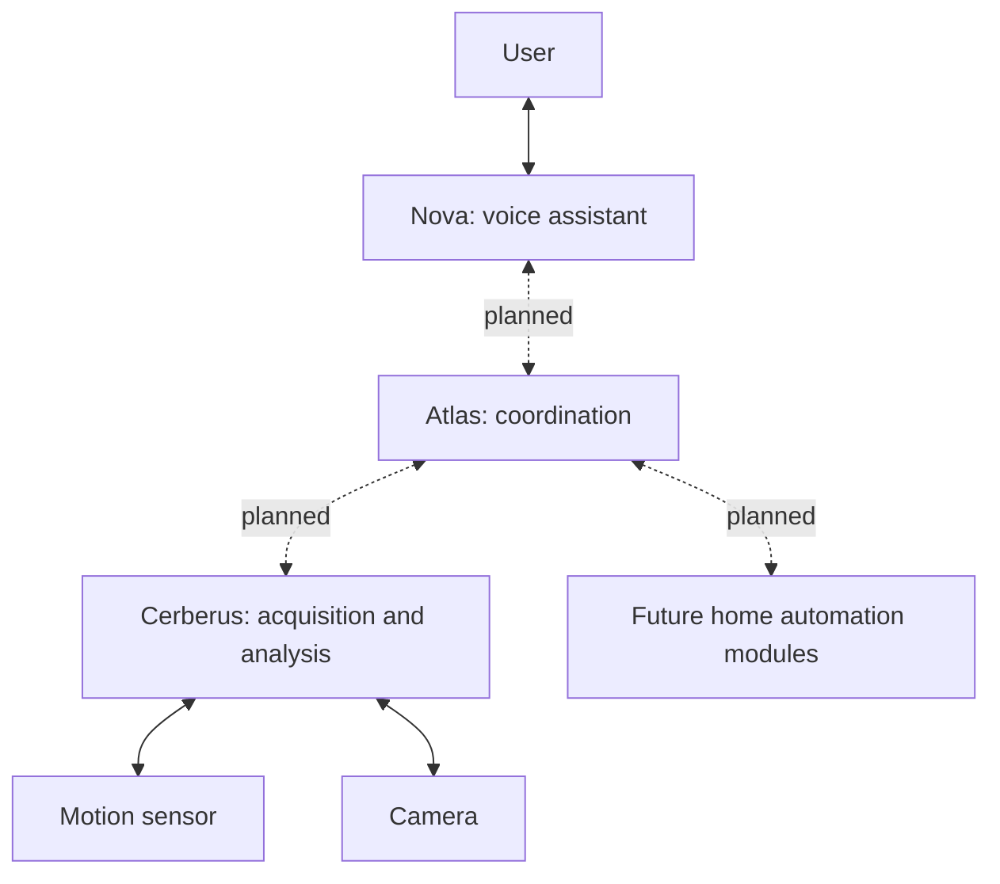

# Project Synapse

Project Synapse brings together a voice assistant, Raspberry Pi sensors and cameras, and a future coordination service. I develop each module independently before connecting them through shared interfaces.

| Module | Purpose | Current state |
|---|---|---|
| [Nova](nova/README.md) | Personal voice assistant | Online and Local conversations, speaker verification and persistent personal memory on an Apple Silicon Mac |
| [Cerberus](cerberus/README.md) | Motion detection and camera acquisition | PIR-triggered capture in C; a standalone Python YuNet script detects faces and saves crops on Mac and Raspberry Pi |
| Atlas | Coordination and personal remote access | Planned |

## Architecture

Nova and Cerberus currently run as independent applications. Atlas will connect conversation requests, device operations and acquisition events.



## Nova

**Neural Omnimodal Virtual Agent** runs on macOS Apple Silicon. It records speech, transcribes it locally, generates a response and speaks through a private FRIDAY voice reference.

| Component | Online | Local |
|---|---|---|
| Conversation | GPT-6 Luna | Ollama Qwen3.5 4B MXFP8 |
| Memory classification | Jev | GLiClass Multilang Mini |
| Transcription | Local Whisper Large V3 Turbo | Same |
| Speech synthesis | Local Qwen3-TTS 1.7B Base 8-bit | Same |
| Personal memory | Local E5 embeddings and Qdrant | Same |
| Speaker verification | Local SpeechBrain ECAPA-TDNN | Same |

After completing the [installation](nova/INSTALL.md), launch from `nova/`:

```sh
.venv/bin/python nova.py
# Or choose a mode directly:
.venv/bin/python nova.py online
.venv/bin/python nova.py local
```

With no mode argument, select Online or Local in the window. Enroll the owner's voice using **Registra la mia voce**. Each new conversation verifies the speaker before enabling personal memory; guests can converse without reading or writing the owner's archive. Stop clears the conversation and its identity while keeping the models loaded.

Explicit memory requests can save validated facts directly. Other proposed memories require confirmation. Retrieval combines semantic similarity with owner, category and state filters. Online mode sends conversation, extraction and retrieved context to OpenAI, and classification text to TypeSafe. Audio processing and the memory database remain local.

See the [Nova README](nova/README.md) for conversation controls, storage and current limitations. The private voice reference is required and is not included in the repository.

## Cerberus

The current hardware is a Raspberry Pi 3 B+, Camera Module 3 NoIR and an HC-SR501 PIR sensor. A rising edge on BCM GPIO18 triggers a synchronous camera capture through a C API backed by libcamera. The image is saved as a 640×480 RGB PPM.

On a configured Raspberry Pi, from the repository root:

```sh
cd cerberus
make cerberus
mkdir -p images
./cerberus
```

The default output is `images/camera-frame.ppm`. Pass an output path to choose another destination:

```sh
./cerberus images/motion.ppm
```

The [Cerberus guide](cerberus/README.md) covers build requirements, sensor configuration and manual capture.

### Face detection

The YuNet script processes a still image with OpenCV, draws face boxes and saves each valid face crop separately. Input dimensions come from the loaded image, crop coordinates are bounded by the image edges, and annotations are drawn on a separate copy.

I have checked single-face and five-person photos on Mac, then run the experiment on the Raspberry Pi without a graphical desktop. The Pi saves JPEG output for inspection on the Mac. Runtime has not yet been benchmarked. Image scale matters: reducing a large portrait resolved partial detections in the initial test.

The script is [cerberus/src/face_detection.py](cerberus/src/face_detection.py). It accepts an input image and an existing output directory as positional arguments. From `cerberus/`, with its Python environment active:

```sh
python src/face_detection.py images/camera-frame.ppm images
```

Use a captured PPM or another supported image as input. The C capture application and Python detector are still run separately; automatic PIR-to-detector integration and identity recognition are still to come.

## Repository layout

```text
cerberus/
  include/        C interfaces for GPIO, camera and capture
  src/            C acquisition, libcamera backend and Python face detector
  Makefile        Motion capture, manual capture and legacy control targets
  README.md       Raspberry Pi setup and usage
nova/
  nova.py         Desktop launcher
  nova_core/      Audio, conversation, identity and memory
  INSTALL.md      Environment and private-asset setup
  README.md       Assistant usage and design
docs/
  control-center.md   Earlier temperature/button/LED prototype
```

Local Keras notebooks, experiments, test utilities, generated images, virtual environments and private assets are kept outside the published source tree. The [Control Center guide](docs/control-center.md) documents the earlier NTC/PCF8591 circuit, which is separate from the current PIR/camera setup.

## Next steps

- Run YuNet on a Cerberus camera image, then connect detection to the acquisition workflow.
- Build a face dataset across separate recording sessions and train a recognizer with Keras, including error analysis and known/unknown evaluation.
- Evaluate Nova's speaker matching and persistent memory across full spoken conversations; add memory correction and deletion controls, then wake word activation and tool use.
- Develop Atlas contracts and coordination, with identity, authorization, TLS, secret handling and access limits before remote exposure.
- Add bounded pre-event video history and event clips, followed by device-specific home automation modules.

## Stack

C handles embedded application logic and Linux GPIO events. A C++ backend exposes libcamera capture through a C interface. Python powers Nova and the face-detection experiment; Keras is used for model development. Nova uses MLX on Apple Silicon, Ollama for local conversation and Qdrant for persistent vector storage.
